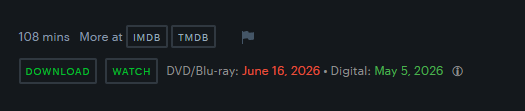

# Letterboxd DL Extension

A browser extension that enhances Letterboxd movie pages by adding:

* A **Download** button that **opens a list of trackers** to access or download the movie.
* A **Watch** button that opens a list of streaming services for the movie.
* **Digital & Blu-ray release dates**, displayed **to the right of the buttons** for quick reference (cached for faster loading).
* A **right-click menu on any film poster or link** on Letterboxd (watchlists, lists, diary), so you can open a source without visiting the film page.
* **Keyboard shortcuts**: `Alt+Shift+D` (Download) and `Alt+Shift+W` (Watch). Use the arrow keys, Enter and Esc in the menu.

## Installation

### Chrome / Chromium Browsers

1. Go to the **Releases** page of this repository  
2. Download the latest release and extract the `.zip` file
3. Open Chrome and go to: `chrome://extensions/`
4. Enable **Developer Mode** (top-right corner)
5. Click **Load unpacked** and select the extracted extension folder

### Firefox

1. Go to the **Releases** page of this repository
2. Download the latest `.xpi` file
3. Open Firefox and press **Ctrl + O**
4. Select the downloaded `.xpi` file
5. Confirm the installation when Firefox prompts you

### Safari (macOS)

Safari extensions must be wrapped in a macOS app, so this needs a Mac with **Xcode** installed.

1. Clone this repository (or download and extract it) on your Mac
2. In Terminal, run: `bash build-safari.sh --build`
3. Open the built **Letterboxd DL.app** once (the path is printed at the end)
4. In Safari, enable **Settings → Advanced → Show features for web developers**, then **Develop → Allow Unsigned Extensions** (Safari turns this off again each time it restarts)
5. Enable **Letterboxd DL** in **Safari → Settings → Extensions**
6. When Safari asks, allow the extension on **letterboxd.com** and **dvdsreleasedates.com**. Release dates need the second one.

Alternatively, run `bash build-safari.sh` without `--build` and open the generated project in `safari-build/` in Xcode, then press **Run**. If you have an Apple Developer account, sign the app in Xcode so you don't need "Allow Unsigned Extensions".

Requires Safari 15.4 or newer.

## Usage

1. Open any **Letterboxd movie page**
2. Find the **Download** and **Watch** buttons near the TMDB and IMDb buttons
3. Click a button to open its sources, then click a source to open it in a new tab
4. Optional: set a **default source** in the extension's settings. The button then opens that source in one click, and the small **▾** next to it shows the full list.

## Settings

Click the extension icon to:

* Enable/disable, **reorder** (drag the ⋮⋮ handle), **edit** and add sources. Built-in sources can be edited and restored to their defaults.
* Hide the Watch button.
* **Clean titles**: strip accents and punctuation (`Amélie` → `Amelie`), which gets more hits on torrent search.
* Add a **quality suffix** (`720p`, `1080p`, `2160p`) to download searches.
* **Export / import** all settings as JSON.

### URL placeholders

| Placeholder | Example | Notes |
|---|---|---|
| `{query}` | `The Matrix 1999` | Depends on the source's search type (Title / Title + Year / IMDb ID) |
| `{title}` | `The Matrix` | |
| `{year}` | `1999` | |
| `{imdb}` | `tt0133093` | |
| `{imdbNum}` | `133093` | IMDb ID without `tt` and leading zeros |
| `{tmdb}` | `603` | Useful for sites that link directly to a film by TMDB ID |
| `{quality}` | `1080p` | The quality suffix, download sources only |

If a page has no IMDb/TMDB link, sources that need that ID are shown greyed out.

## Screenshot

